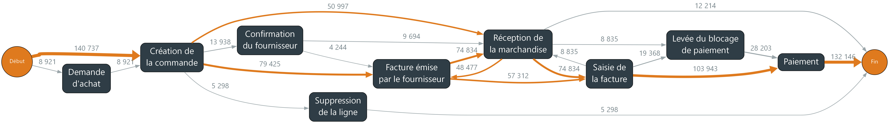
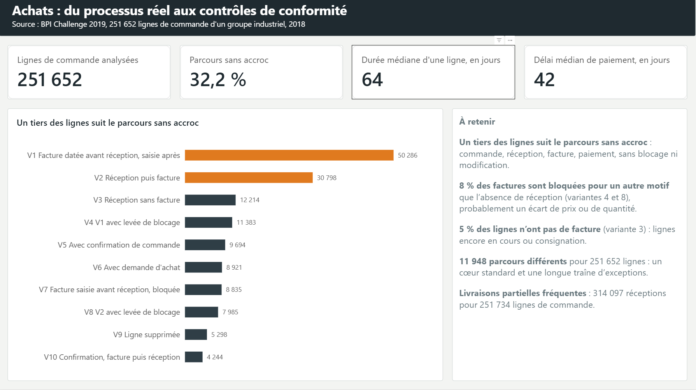
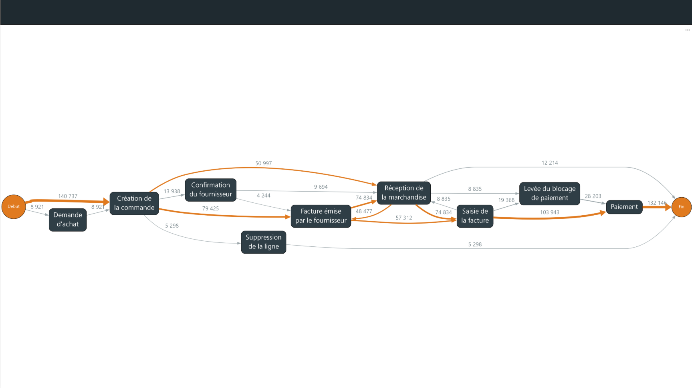
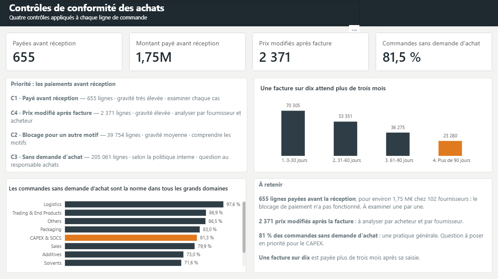

# Processus d'achat : du parcours réel des commandes aux contrôles de conformité

Données réelles extraites du logiciel de gestion SAP d'un grand groupe industriel de peintures : 251 652 lignes de commande de 2018. Une ligne de commande correspond à un article commandé.

## En bref

- **Question** : les achats suivent-ils le circuit prévu, de la commande au paiement ?
- **Démarche** : reconstituer le parcours réel de chaque ligne à partir des 1,6 million d'étapes enregistrées par le logiciel (c'est le *process mining*), puis appliquer quatre contrôles de conformité.
- **Résultats** : un tiers des lignes sans accroc ; 655 lignes payées avant la réception de la marchandise, pour environ 1,75 M€ ; 81 % des commandes sans demande d'achat (la demande interne qui précède normalement la commande).
- **Recommandation** : traiter d'abord les 655 lignes payées avant réception, puis revoir le blocage du paiement en « facture avant réception » : 102 fournisseurs sont concernés, c'est le processus qu'il faut corriger, pas un fournisseur.
- **Limite** : une seule entreprise sur une seule année, et le montant d'environ 1,75 M€ est la valeur cumulée des lignes, pas le montant payé.
- **Outils** : Python, SQL, dbt, Power BI.



*Les dix parcours les plus fréquents. En orange, le parcours sans accroc : commande, réception, facture, paiement. Plus la flèche est épaisse, plus le passage est fréquent.*

## Ce que j'ai trouvé

1. **Priorité 1 : 655 lignes payées avant la réception** (environ 1,75 M€, 102 fournisseurs), alors que la règle l'interdit : le blocage automatique n'a pas fonctionné.
2. **Priorité 2 : 2 371 prix modifiés après la facture**, un signal d'alerte classique en audit.
3. **Priorité 3 : 39 754 paiements bloqués pour un autre motif que la réception**, probablement un écart de prix ou de quantité.
4. **81 % des commandes sans demande d'achat**, dans tous les domaines : une pratique générale, donc une question à poser au responsable des achats, pas une anomalie à traiter ligne par ligne.

## Compétences mobilisées

- **Processus achats et SAP** : suivre une commande de la demande d'achat au paiement et retrouver chaque étape dans les tables SAP ([fiche pratique](docs/fiche_sap.md)). Mon passé en logistique m'a aidé à lire les livraisons partielles et les prestations logistiques commandées sans demande d'achat.
- **Process mining** : parcours réels, carte du processus, délais.
- **Contrôles de conformité** : quatre contrôles conçus, puis classés par gravité et par volume.
- **Modélisation de données** : chaîne SQL en trois étapes, testée automatiquement avec dbt.
- **Esprit critique sur les données** : dates aberrantes écartées, deux hypothèses de départ corrigées par les chiffres.
- **Restitution** : tableau de bord Power BI lisible sans bagage technique.

## Outils

Python (PM4Py, pandas) · SQL (DuckDB, dbt) · Graphviz · Power BI · Git

---

## Détails techniques

- [Données](#données)
- [Architecture](#architecture)
- [Le lien avec SAP](#le-lien-avec-sap)
- [Analyse du processus](#analyse-du-processus)
- [Les quatre contrôles](#les-quatre-contrôles)
- [Tableau de bord](#tableau-de-bord)
- [Enseignements et difficultés](#enseignements-et-difficultés)
- [Limites](#limites)
- [Arborescence du dépôt](#arborescence-du-dépôt)
- [Reproduire le projet](#reproduire-le-projet)

### Données

- **Source** : BPI Challenge 2019, Boudewijn van Dongen, 4TU.ResearchData, DOI [10.4121/uuid:d06aff4b-79f0-45e6-8ec8-e19730c248f1](https://doi.org/10.4121/uuid:d06aff4b-79f0-45e6-8ec8-e19730c248f1).
- **Licence** : CC BY 4.0, vérifiée sur la page du jeu de données.
- **Contenu** : 1 595 923 événements, 251 734 lignes de commande, 42 activités différentes, commandes de 2018. Un événement est une étape datée du parcours d'une ligne (création de la commande, réception, saisie de la facture, paiement…). L'entreprise est un groupe multinational basé aux Pays-Bas ; la description du jeu évoque une soixantaine de filiales.
- **Nettoyage** : 82 lignes de commande (0,03 %) contiennent une date aberrante, entre 1948 et 2016 ou en 2020. Elles sont exclues en entier, car supprimer seulement l'événement fautif fausserait les délais. Restent 251 652 lignes.

**Types de rapprochement.** Le rapprochement est la vérification faite avant de payer une facture. À 3 voies, la commande, la réception et la facture doivent concorder. À 2 voies, seules la commande et la facture sont comparées. En consignation, le fournisseur met du stock à disposition et la facturation passe par un processus séparé.

| Type de rapprochement | Lignes | Part |
|---|---:|---:|
| 3 voies, facture avant réception (`3-way match, invoice before GR`) | 220 948 | 87,8 % |
| 3 voies, facture après réception (`3-way match, invoice after GR`) | 15 162 | 6,0 % |
| Consignation (`Consignment`) | 14 498 | 5,8 % |
| 2 voies (`2-way match`) | 1 044 | 0,4 % |

### Architecture

```
data/raw/BPI_Challenge_2019.xes        journal d'événements au format XES (695 Mo)
        │  python/conversion.py        lecture avec PM4Py
        ▼
data/processed/evenements.parquet      même contenu, format en colonnes compact
        │  dbt build                   modèles SQL exécutés dans DuckDB
        ▼
data/p2p.duckdb                        staging → intermediate → marts, 7 tests
        │  python/variantes.py, carte_lisible.py, synthese_controles.py
        ▼
parcours types, carte du processus, résultats des contrôles
        │  python/export_powerbi.py
        ▼
outputs/powerbi/controles.parquet  →  powerbi/p2p_dashboard.pbix
```

DuckDB est une base de données analytique contenue dans un seul fichier. dbt organise les transformations SQL en couches et les teste.

| Couche | Modèle | Rôle | Matérialisation |
|---|---|---|---|
| staging | `stg_evenements` | Renomme les colonnes du journal en français, sans autre transformation | vue |
| intermediate | `int_evenements_valides` | Exclut les 82 lignes de commande aux dates aberrantes | table |
| marts | `fct_lignes_commande` | Une ligne par ligne de commande : dates, durée, nombre de réceptions, de factures et de modifications, valeur | table |
| marts | `fct_controles` | Dates clés, délai de paiement et résultat des quatre contrôles pour chaque ligne | table |

Tests dbt : unicité et présence de l'identifiant dans les deux marts, valeurs autorisées pour le type de rapprochement, présence de la durée et du contrôle C1.

### Le lien avec SAP

Le journal d'événements n'existe pas tel quel dans SAP : il est reconstruit à partir de plusieurs tables.
La commande vient d'EKKO et EKPO, la réception de MKPF/MSEG (MATDOC en S/4HANA), la facture de RBKP/RSEG et le paiement de BSAK (ACDOCA en S/4HANA).
Chaque colonne du journal correspond à un champ SAP, par exemple EKKO-EBELN pour le numéro de commande ou EKPO-WEPOS pour la réception attendue. Détail complet : [docs/fiche_sap.md](docs/fiche_sap.md).

### Analyse du processus

**Variantes.** Une variante est la suite exacte d'étapes suivie par une ligne de commande. Les 251 652 lignes suivent 11 948 variantes. Les 10 principales couvrent 59,5 % des lignes, et 9 006 variantes ne concernent qu'une seule ligne : un cœur standard et une longue traîne d'exceptions.

| Variante | Lignes | Part |
|---|---:|---:|
| V1 Facture datée avant réception, saisie après | 50 286 | 20,0 % |
| V2 Réception puis facture | 30 798 | 12,2 % |
| V3 Réception sans facture | 12 214 | 4,9 % |
| V4 V1 avec levée de blocage | 11 383 | 4,5 % |
| V5 Avec confirmation de commande | 9 694 | 3,9 % |
| V6 Avec demande d'achat | 8 921 | 3,5 % |
| V7 Facture saisie avant réception, bloquée | 8 835 | 3,5 % |
| V8 V2 avec levée de blocage | 7 985 | 3,2 % |
| V9 Ligne supprimée | 5 298 | 2,1 % |
| V10 Confirmation, facture puis réception | 4 244 | 1,7 % |

- **Parcours sans accroc** (V1 et V2 : commande, réception, facture, paiement, sans blocage) : 32,2 % des lignes.
- **V3**, réception sans facture : lignes encore en cours ou en consignation.
- **V4 et V8** : levée d'un blocage de paiement alors que la réception précédait la facture. Le blocage avait donc un autre motif, probablement un écart de prix ou de quantité. 19 368 lignes, environ 8 %.
- **V6** est la seule variante principale qui commence par une demande d'achat.

**Carte du processus.** `python/carte_lisible.py` dessine avec Graphviz les 10 variantes principales : libellés courts en français, épaisseur des flèches proportionnelle au nombre de lignes, parcours sans accroc en orange (`outputs/carte_processus_fr.png`). Les cartes générées par PM4Py restent dans `outputs/` pour comparaison.

**Délais.**

- Durée d'une ligne, de la première à la dernière étape : médiane 64 jours, moyenne 69,4 jours, maximum 819 jours.
- De la saisie de la facture au paiement : médiane 42 jours, 90 % en moins de 97 jours, maximum 342 jours. Ce délai reflète probablement les conditions de paiement plutôt qu'une inefficacité. La vraie question est le dépassement d'échéance, qui ne peut pas être mesuré sans les conditions négociées.
- Livraisons partielles : 314 097 réceptions pour 251 734 lignes de commande (données brutes).

### Les quatre contrôles

Les contrôles sont calculés dans le modèle dbt `fct_controles`, une ligne par ligne de commande. Ils sont classés par gravité et par volume : C1 d'abord, car grave et traitable, puis C4, puis C2. C3 relève d'une question au responsable des achats.

| Priorité | Contrôle | Définition | Lignes | Gravité | Action |
|---:|---|---|---:|---|---|
| 1 | C1 Payé avant réception | Ligne en rapprochement à 3 voies payée sans réception, ou avant la première réception | 655 | Très élevée | Examiner chaque cas, revoir le blocage automatique |
| 2 | C4 Prix modifié après facture | Prix changé après la première saisie de la facture | 2 371 | Élevée | Analyser par fournisseur et par acheteur |
| 3 | C2 Blocage pour un autre motif | Blocage de paiement levé alors que la réception précédait la facture | 39 754 | Moyenne | Comprendre les motifs : écart de prix, de quantité |
| 4 | C3 Sans demande d'achat | Commande créée sans demande d'achat | 205 061 (81,5 %) | Selon la politique interne | Question au responsable des achats |

- **C1** : environ 1,75 M€ en jeu, chez 102 fournisseurs. 654 des 655 lignes sont en « facture avant réception », catégorie où SAP doit justement bloquer le paiement jusqu'à la réception : c'est une défaillance de contrôle. Le problème est dispersé entre de nombreux fournisseurs, la piste est donc le processus plutôt qu'un fournisseur.
- **C3** : entre 70 % et 98 % dans tous les grands domaines d'achat. Logistics atteint 97,6 %, ce qui est cohérent pour des prestations récurrentes. CAPEX & SOCS atteint 81,3 %, à signaler car il s'agit d'investissements. 3 287 lignes n'ont pas de domaine d'achat renseigné, un point de qualité des données.

### Tableau de bord

Le fichier `powerbi/p2p_dashboard.pbix` contient trois pages.

**Page 1, le processus** : quatre indicateurs (lignes analysées, part des parcours sans accroc, durée médiane d'une ligne, délai médian de paiement), les dix variantes principales et un encadré « À retenir ».



**Page 2, la carte** : la carte des dix parcours les plus fréquents.



**Page 3, les contrôles** : les quatre contrôles chiffrés et leur ordre de priorité, la répartition des délais de paiement (une facture sur dix attend plus de trois mois) et la part des commandes sans demande d'achat par domaine.



### Enseignements et difficultés

**Ce que les données m'ont appris**

- **Les données ont corrigé deux hypothèses.** La catégorie « facture avant réception » n'est pas l'exception : elle couvre 88 % des lignes. Et le schéma théorique (facture saisie avant la réception, bloquée, puis débloquée) ne concerne que 3,5 % des lignes.
- **Un taux massif signale une politique, pas une anomalie.** Avec 81,5 % de commandes sans demande d'achat, on ne contrôle pas ligne par ligne : on pose la question de la règle.
- **La médiane décrit mieux un délai que la moyenne**, car quelques lignes très longues (jusqu'à 819 jours) tirent la moyenne vers le haut.

**Difficultés techniques**

- **PM4Py et pandas** : la fonction de PM4Py qui filtre les variantes principales est incompatible avec le format texte récent de pandas. Je l'ai remplacée par un filtrage maison : trier les étapes de chaque ligne, les assembler en une suite, puis compter les suites identiques.
- **Chemin relatif dans dbt** : la vue de staging lit le Parquet par un chemin relatif à `dbt/p2p`, et ne fonctionne donc que depuis ce dossier. Les modèles intermediate et marts sont matérialisés en tables, lisibles depuis Python ou Power BI quel que soit le dossier.
- **Carte illisible** : la carte complète produite par PM4Py était illisible. Je l'ai remplacée par une carte Graphviz dessinée sur mesure.

### Limites

- Les intitulés de domaine d'achat (Packaging, CAPEX & SOCS…) sont propres à l'entreprise et ne sont pas documentés.
- Le montant de C1 est un ordre de grandeur : il repose sur la valeur cumulée des lignes, pas sur le montant exact payé.
- Sans les conditions de paiement négociées, on ne peut pas affirmer qu'une facture est payée en retard.
- Les données portent sur une seule entreprise et une seule année.

### Arborescence du dépôt

```
.
├── README.md
├── requirements.txt
├── data/
│   └── raw/README.md              où télécharger le jeu (données non versionnées)
├── python/
│   ├── conversion.py              XES → Parquet, avec PM4Py
│   ├── exploration.py             premier aperçu, repérage des dates aberrantes
│   ├── controle_dbt.py            vérification des tables dbt, durée des lignes
│   ├── variantes.py               comptage des variantes
│   ├── carte_lisible.py           carte du processus, avec Graphviz
│   ├── carte_processus.py         cartes PM4Py, première version
│   ├── synthese_controles.py      résultats des quatre contrôles
│   └── export_powerbi.py          table pour Power BI
├── dbt/p2p/
│   ├── dbt_project.yml
│   ├── profiles.example.yml       exemple de profil DuckDB
│   └── models/
│       ├── staging/               sources.yml, stg_evenements.sql
│       ├── intermediate/          int_evenements_valides.sql
│       └── marts/                 fct_lignes_commande.sql, fct_controles.sql, schema.yml
├── outputs/
│   ├── carte_processus_fr.png     carte retenue
│   ├── carte_frequence.png        carte PM4Py, fréquences
│   └── carte_delais.png           carte PM4Py, délais médians
├── powerbi/
│   └── p2p_dashboard.pbix
└── docs/
    ├── fiche_sap.md               où trouver quoi dans SAP
    ├── page1_processus.png
    ├── page2_carte.png
    └── page3_controles.png
```

### Reproduire le projet

**1. Environnement Python 3.12**

```powershell
py -3.12 -m venv .venv
.venv\Scripts\Activate.ps1        # macOS ou Linux : source .venv/bin/activate
pip install -r requirements.txt
```

**2. Graphviz** : installer le programme Graphviz (https://graphviz.org/download/), pas seulement le paquet Python, pour que la commande `dot` soit disponible. Sous Windows, les scripts ajoutent `C:\Program Files\Graphviz\bin` au PATH s'il manque.

**3. Données** : télécharger le fichier XES comme indiqué dans [data/raw/README.md](data/raw/README.md), puis le convertir en Parquet :

```powershell
python python/conversion.py
```

**4. dbt** : lancer depuis `dbt/p2p`, car les chemins vers `data/` sont relatifs à ce dossier.

```powershell
cd dbt/p2p
copy profiles.example.yml profiles.yml    # macOS ou Linux : cp
dbt build
cd ../..
```

**5. Analyses**, depuis la racine du dépôt :

```powershell
python python/exploration.py
python python/controle_dbt.py
python python/variantes.py
python python/carte_lisible.py
python python/carte_processus.py          # facultatif : cartes PM4Py
python python/synthese_controles.py
python python/export_powerbi.py
```

**6. Power BI** : ouvrir `powerbi/p2p_dashboard.pbix` dans Power BI Desktop. Les données sont importées dans le fichier, qui s'ouvre sans relancer la chaîne. Pour l'actualiser, faire pointer la source vers `outputs/powerbi/controles.parquet` (Accueil > Transformer les données > Paramètres de la source de données).

---

## Contact

<div align="center">

### Alexis Claudeon
**Data Analyst | Analytics Engineer junior**

[](https://github.com/Alexis45140)
[](https://www.linkedin.com/in/alexis-claudeon)
[](mailto:alexis.claudeon@outlook.fr)

</div>
